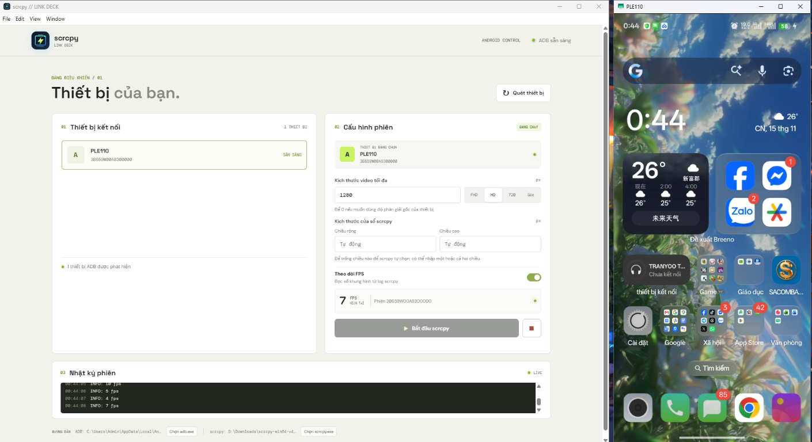

# Link Deck

**Link Deck** là ứng dụng desktop giúp kết nối và điều khiển điện thoại Android từ máy tính thông qua scrcpy. Dự án sử dụng và cải tiến mã nguồn của [scrcpy](https://github.com/Genymobile/scrcpy), đồng thời bổ sung giao diện tiếng Việt để quản lý thiết bị và cấu hình phiên sử dụng thuận tiện hơn. Ứng dụng có thể dùng với nhiều dòng điện thoại nội địa, miễn là thiết bị cho phép bật USB debugging, chấp nhận kết nối ADB và được máy tính nhận diện.

> Đây là dự án không chính thức, không thuộc hoặc được bảo trợ bởi Genymobile hay nhóm phát triển scrcpy.

## Ảnh minh họa



## Tính năng

- Tự dò và quét lại các thiết bị Android đã kết nối qua ADB; chọn thiết bị để bắt đầu phiên.
- Kết nối thiết bị qua USB hoặc Wi-Fi khi thiết bị đã được kết nối bằng ADB.
- Tùy chỉnh kích thước video tối đa, với lựa chọn nhanh FHD, HD, 720p hoặc độ phân giải gốc.
- Tùy chỉnh chiều rộng và chiều cao cửa sổ scrcpy độc lập.
- Bật hoặc tắt theo dõi FPS và xem FPS hiện tại trong phiên.
- Bắt đầu, dừng phiên scrcpy và theo dõi nhật ký hoạt động ngay trên giao diện.
- Tự dò ADB trong Android SDK/PATH; cho phép chọn thủ công `adb.exe` và `scrcpy.exe`. Đường dẫn đã chọn được lưu cho lần sử dụng sau.

## Yêu cầu

- Windows.
- Node.js và npm để chạy hoặc đóng gói launcher.
- `adb.exe` (Android SDK Platform-Tools) và `scrcpy.exe`.
- Thiết bị Android đã bật USB debugging. Với kết nối Wi-Fi, hãy kết nối thiết bị qua ADB trước khi quét.

## Chạy ứng dụng

Mở PowerShell tại thư mục `launcher` và chạy:

```powershell
npm install
npm start
```

Trong ứng dụng, chọn thiết bị, điều chỉnh cấu hình phiên nếu cần rồi nhấn **Bắt đầu scrcpy**. Nếu launcher chưa tự tìm thấy ADB hoặc scrcpy, dùng các nút **Chọn adb.exe** và **Chọn scrcpy.exe** ở cuối cửa sổ.

## Đóng gói

Tại thư mục `launcher`, chạy:

```powershell
npm run dist
```

Gói cài đặt Windows được tạo trong `launcher/dist`.

## Mã nguồn và ghi nhận

Link Deck được xây dựng trên mã nguồn scrcpy của [Genymobile](https://github.com/Genymobile/scrcpy) và có bổ sung, điều chỉnh cho dự án này. scrcpy được phát hành theo giấy phép Apache License 2.0; vui lòng xem tệp [LICENSE](LICENSE) và giữ nguyên các thông tin bản quyền, giấy phép liên quan khi sử dụng hoặc phân phối mã nguồn.
